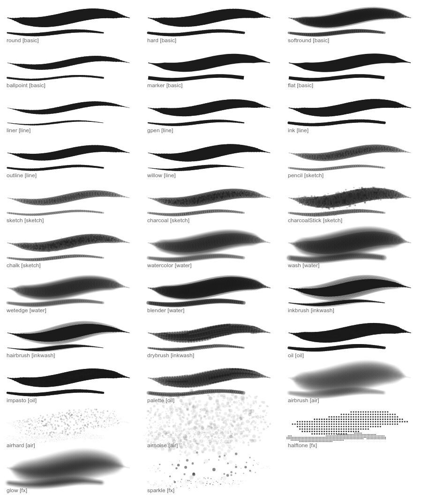

# 画界 · Xenra DrawWorld

**在 DeepSeek Harness 里放一块真正属于你的画布。**


画布是**数据**而不是截图：每一笔都是带压感的点序列，存在 `doc.json` 里。
你和模型在同一份文档上画——你用鼠标，模型用 `paint_canvas` 工具，界面做的每件事工具里都有对应动作。

- 两个入口：左栏「画界」整页画板，或右栏一个边聊边画的画布标签页，共用同一份画布。
- 32 支参数化笔刷、8 个分类、13 种落笔方式，笔笔有压感。
- 图层：缩略图、显隐、不透明度、正片叠底、真擦除（擦成透明，露出下层）。
- 模型侧一个 `paint_canvas` 工具，13 个动作覆盖画、改、看、导出、新建。
- **按会话绑定**：只有打开过画界的会话才拿得到画布工具，别的会话不会被画布协议带偏。

## 安装

插件是本地目录安装，没有第三方依赖（纯 ESM，渲染在浏览器里做）。两种装法：

**A. 从仓库地址装（推荐，便于更新）**

在 DeepSeek Harness 的插件管理里填安装地址，任选其一：

```
github:RUO-MO/dsh-draworld
https://github.com/RUO-MO/dsh-draworld
```

插件管理器会先用 `git ls-remote` 检查仓库连通性，再用 pnpm 装源码（仓库无构建脚本，`--ignore-scripts` 即可）。
需要本机有 `git`、能访问 `github.com`；**用 https，不要用 ssh**——很多网络下 22 端口被拒。

**B. 从本地目录装**

1. 下载 [最新 Release](https://github.com/RUO-MO/dsh-draworld/releases) 的 zip 解压，或 `git clone https://github.com/RUO-MO/dsh-draworld.git`。
2. 插件管理里添加这个目录。

装完都要**停用再启用**（宿主代码生效）；只改界面代码时 `Ctrl+R` 刷新页面即可。
想确认装的是新版本：打开画界后访问 `http://127.0.0.1:<DSH端口>/canvas-api/diagnostics`，`api=3`、`scope.mode=session`。

> **更新**：GitHub Release 只是下载页，不会向已装用户推送。用方式 A 装的，用同一条地址再装一次（或 `pnpm update`）就会拉到最新提交；用方式 B 装的，需要自己替换目录里的文件。插件管理器的「可更新」角标只覆盖官方目录条目，自建仓库不会显示。

> 插件管理按 `package.json` 的 `version` 判断版本。本地目录装了插件、文件改了但版本号没动，它不认——升级请先改版本号。

## 界面

### 整页模式（左栏「画界」）

按四块分区：

- **C1 顶栏**：`xenra.画界` 标识，右侧「＋ 新建」「右栏画布」「回到对话」。
- **A1 画板**：占满左侧，滚轮缩放（0.06×~16×，以指针为锚）、空格/中键平移、右下角缩放 HUD（`−` / 百分比 / `＋` / 适应 / 1:1）。
- **A1 右侧 图层视窗**：见下面「图层」一节，可折叠成 34px 窄轨。
- **B1 右上**：当前工具按钮（点开是弹窗卡片，选笔/擦/线/矩形/圆，八类 32 支笔刷每格带样笔预览）、颜色、笔宽、图层开关。
- **B2 右下**：撤销 / 重做 / 回放 / 清空，以及「画布 1024×1024」按钮（点开是尺寸预设、背景、缓存目录、保存路径、另存 PNG）。

### 右栏模式

右栏「开始」列表里的**画界**一行，点开在右侧开一个画布标签页，边聊边画。窄条版只保留画板与最小工具行，图层与设置仍在整页模式里。

配色全部使用宿主真实设计变量（`--dsw-alias-label-primary/secondary/tertiary/caption`、`--dsw-alias-bg-layer-1/2/3`、`--dsw-alias-border-l1/l2/l3`、`--dsw-alias-brand-primary`），浅色主题下不会白字白底。

## 画笔

一支笔四个可调量：**工具**（笔/擦/线/矩形/圆）、**笔刷**、**颜色**、**笔宽**，外加「起收笔渐细」开关。
笔刷照画世界Pro 的画笔库分八类共 32 支，差别都在渲染上（`engine` 不同，不是换名字）：

| 分类 | 笔刷 |
|---|---|
| 常规 | `round` 圆头、`hard` 硬边圆、`softround` 软边圆、`ballpoint` 圆珠笔、`marker` 马克笔、`flat` 平头 |
| 勾线 | `liner` 勾线笔、`gpen` G 笔、`ink` 墨水笔、`outline` 描边笔、`willow` 柳叶笔 |
| 铅笔 / 素描 | `pencil` 铅笔、`sketch` 素描铅笔、`charcoal` 炭笔、`charcoalStick` 炭条、`chalk` 粉笔 |
| 水彩 | `watercolor` 水彩笔、`wash` 铺色、`wetedge` 湿边、`blender` 晕染 |
| 水墨 | `inkbrush` 水墨毛笔、`hairbrush` 尖锋毛笔、`drybrush` 干笔 |
| 油画 / 厚涂 | `oil` 油画笔、`impasto` 厚涂、`palette` 刮刀 |
| 喷枪 | `airbrush` 软喷枪、`airhard` 硬喷枪、`airnoise` 噪点喷枪 |
| 特效 | `halftone` 漫画网点、`glow` 光效、`sparkle` 粒子 |



十三种落笔方式（`BRUSH_ENGINES`）撑着这 32 支，加一支只在表里加一行参数：

- **solid** 实边 ribbon，宽度随压感变；**flat** 平头/方头等宽（马克、平头、刮刀）
- **soft** 多层渐宽 —— 软边圆、晕染
- **grain** 淡底 + 颗粒散点 —— 铅笔、素描、炭笔、炭条；种子取笔迹 id，**回放与导出永远一致**
- **chalk** 颗粒再叠一层粗粉点
- **dry** 沿法线劈成几股细毛、随机断开的飞白 —— 干笔、刮刀
- **wet** 淡圆斑、边缘比中心深（湿边），叠几笔才出浓度 —— 水彩三支
- **inkflow** 外圈淡墨 + 实心芯 —— 水墨毛笔、尖锋毛笔
- **oil** 厚底 + 毛刷拖痕，`thick` 多压一遍 —— 油画、厚涂
- **spray** 按点撒小圆 —— 三种喷枪（软/硬/噪点靠散布与半径区分）
- **halftone** 按格挑点、每格一个圆 —— 漫画网点，密处自然连片
- **glow** 径向渐变叠光晕；**scatter** 稀疏粒子 + 偶尔大光斑

`taper=true` 时两端按 15% 长度渐细到 `minSize`（默认取笔刷自带值，0~1），形状工具不吃这一套。
橡皮固定走圆头实心 `destination-out`，不吃笔刷参数。

模型侧同一套：`draw` 带 `brush`（32 个 id 之一，未知值回退 `round`）、`taper`、`minSize`。
系统提示里的用法建议：描线用 `liner/gpen/ink` + taper，草稿用 `pencil/sketch`，排线用 `charcoal`，铺底用 `wash/watercolor`，厚涂用 `oil/impasto`，光晕用 `airbrush/glow`，网点才用 `halftone`。

## 图层

文档是 v2 结构：`layers[{ id, name, visible, opacity, blend, strokes }]`，每笔带全局 `seq`；旧版顶层 `strokes` 的文档读进来会自动搬进第一层并落盘成 v2。

右侧「图层」视窗（照画世界Pro 的侧边 dock）：

- 头部：`图层` + 层数 + `›` 收起；收起后是 34px 窄轨（`▤` + 竖排「图层」+ 层数），点一下展开。
- 列表：上层在上，每行有**30px 真实缩略图**（按该层笔迹/图片缩小渲染）、眼睛 `◉/○`、层名、`N 笔`、不透明度、`正片叠底` 标记；当前层高亮，点行即切当前层。
- 底部：当前层不透明度滑杆（拖动时先用本地值，不等轮询回包）、混合模式（正常 / 正片叠底）、`＋ 新建层`、`删除`。
- 缩略图只在“这一层笔迹数变了”时重画，多图层也不会拖慢画布。

其它行为：

- 橡皮擦成透明（`destination-out`），露出下层，不涂背景色；
- 带橡皮、不透明度或混合模式的层先画到离屏再合成，擦不到背景；
- 撤销/重做是数据，重启后仍可重做（redo 栈随文档落盘，上限 200 笔）；
- 图层可按名字引用：`layer="线稿"`，不存在会自动建。

## 新建一幅

顶栏「＋ 新建」两步：

1. **当前这幅要不要留？**「保存并新建」把当前渲染存成 PNG（`画界-<时间>.png`，落在保存路径）；「不保存，直接新建」丢掉旧画布；「取消」什么都不做。
2. **新画布怎么来？**「空白画布」挑尺寸（1:1 / 4:3 / 16:9 / 9:16 / A4 / 当前尺寸，另有「更多尺寸 / 背景」跳到画布设置）；「导入图片」选 PNG/JPEG/WebP/GIF——**画布尺寸取图片尺寸**，图片压成最底层（图层 1），上面原空层改名「绘画」并设为当前层，点开就能描。

对应 `POST /canvas-api/new`（`{ save, width, height, background, dataUrl|path, name }`）与 `paint_canvas action=new`。

## 图片层

「新建时用图片建画布」（推荐，尺寸跟图走）或「图层弹窗里导入到当前画布」（作为最底层，默认 `contain` 居中，也支持 `cover`/`stretch`）。

素材存进 `<缓存目录>/images/`，用 `/canvas-api/image/<file>` 取原字节；前端预载后参与同一套图层合成，所以显隐、不透明度、正片叠底、导出、透明底导出对图片层一样生效；换缓存目录时 `images/` 跟着搬。

## 画布设置与预设

在 B2 的「画布」卡片里（和整页画板并排，改完立刻看得见）：

- 尺寸预设 —— 比例：1:1 1024、4:3 1024×768、3:4 768×1024、16:9 1024×576、9:16 576×1024；纸张 300dpi：1920×1080、A4 2480×3508、A5 1748×2480、A6 1240×1748、B5 2079×2953；像素画布：16/32/64/128/256/512。
- 自定义宽高 16~4096、背景色 `#rrggbb`；
- **缓存目录**：`doc.json` 与 `preview.png` 放哪。改它会把画布整体搬过去；新目录已有 `doc.json` 就读新的，没有就沿用当前，不会把画了一半的画弄丢。
- **保存路径**：默认 `<缓存目录>/exports/`，另存成品落这里。
- 「另存当前画布」把最新渲染存成 PNG（可勾透明底）。

路径只接受绝对路径，目录不存在会自动创建；这两条存在 `<插件根>/settings.json`，和画布数据分开，所以缓存目录可以随便挪。改尺寸不挪动已有笔迹，只改画布边界。

## 画布视角

缩放/平移只改视图，不改文档坐标；落笔坐标走 `canvas.getBoundingClientRect()`（已含 CSS 变换），放大到 800% 落笔也不会偏。用户没手动缩放过时，视口尺寸变化会重新「适应」，手动缩放之后就不再抢。

## 模型接口

`paint_canvas` 一个工具，`action` 23 个：

| 动作 | 说明 |
|---|---|
| `doc` | 看尺寸、图层、笔迹数、颜色、内容范围、版本；图层带 `image` 就是图片层 |
| `copy` | **一键复刻**：`style=lineart/flat/anime`，自动抽轮廓 + 区域配色，建「色块 / 线稿」两层，并顺带跑 compare 返回覆盖率；`colors`、`minFill` 可调 |
| `fix` | **自动补漏**：只看 compare 的 `topGaps` 重描最漏的几块，`target=90`、`maxRounds=3`，达标或没得补就停，返回每轮数字 |
| `draw` | 一笔：稀疏控制点 + 每点压感，颜色/笔宽/不透明度/笔刷/taper 自定；`layer="线稿"` 按名落层；`shape=line/rect/ellipse` 只给两个对角点；`batches=[…]` 一次交多笔；`mirror=x/y` 同时镜像画 |
| `view` | 取最新渲染；**`rect=[x,y,w,h]` 裁切 + `zoom=1~8` 放大 + `layer="线稿"` 只看单层**，并返回每层包围盒 `bbox` 与覆盖率 `inkPct` |
| `ref` | 参考图导出：整张直接给原图路径，或 `rect`+`zoom` 裁一块出来，用 `read_image` 看细节 |
| `trace` | 参考图 → 轮廓折线：返回 `paths`（画布坐标，直接当 draw 的 points），`threshold` 调深浅、`tolerance` 调概括；已经过 3×3 模糊 + RDP 简化，细线不会碎成双线 |
| `pick` | 读某点颜色与透明度（`x`、`y`，`on=ref/canvas`）：`ink=true` 说明这点在线条上 |
| `compare` | 当前画面 vs 参考图：差分图（品红=漏画、青=多画）+ `coveragePct`、`extraPct`、`meanColorDiff`、`topGaps`（最漏的几块） |
| `palette` | 参考图主色聚类（真 k-means，`k` 2~8）+ 每色占比 |
| `snapshot` / `restore` | 整幅存档 / 回到某一版（比逐笔 undo 干净，跨进程也在） |
| `layer` | `layerOp=list/add/select/set/remove`；`set` 改 `name`、`visible`、`layerOpacity`、`blend`、`locked`（锁住就画不上去、也擦不掉） |
| `import` | 本机图片或 dataUrl 导入成最底层；`fit=contain/cover/stretch` |
| `canvas` | 改尺寸（16~4096）与背景 |
| `new` | 另起一幅：可先 `save` 存当前，或给 `path`/`dataUrl` 按图建画布 |
| `export` | 把最新渲染另存 PNG 到保存路径（`transparent=true` 取透明底） |
| `undo` / `redo` | 按全局顺序撤/恢复最近 N 笔 |
| `clear` | 清空整幅；带 `layer` 只清那层（`all`/`*` 等同整幅） |

**复刻一张图**的闭环：最省模型能力的是 `copy` → `fix` 两条命令；想手工精修再按 `ref` 看细节 → `palette` 定配色 → `trace` 抽轮廓 → `pick` 确认某点在不在线上 → `draw`（长线用 `batches`）→ `view layer=… rect=… zoom=2` 看自己那块 → `compare` 看差多少（`coveragePct` 往 90+ 推、`extraPct` 压下去）→ 收尾前 `snapshot` 兜底。整段流程与协议文本都写进了会话提示词，模型看得到。

**像素任务**：裁切、取色、差分、主色这些活在前端算——浏览器早就把参考图解码进 `<canvas>` 了，宿主只搬运，不引 `@napi-rs/canvas` 这类依赖。宿主把任务塞队列，前端 700ms 轮询 `/canvas-api/jobs` 取走，算完 POST `/canvas-api/job`，宿主落盘成 PNG 或转成折线/数值交给模型。超时 5 秒，报错会直说「需要在浏览器里打开画界面板」。

**会话绑定**：工具和画布协议挂在 `agent.ctx` 上，只有打开过画界的会话才有。打开画界时前端 POST `/canvas-api/attach`（带 `sessionId`），关掉 15 秒后 `/detach`；会话未加载时先挂起，`agent/created` 到达即补绑。想退回「所有会话都有」的旧行为：插件配置写 `toolScope: "global"`（不推荐，会把正在写代码的会话带偏）。

**单一文档**：同一缓存目录只保留一个内存文档（`Document.forDir`，按目录缓存到 `globalThis`），插件被重复加载也不会出现两份各画各的；每次请求与每次工具执行前都核对 `doc.json` mtime，别的窗口刚画过就整份换成更新的那版，避免「模型画了但界面不更新」。

## HTTP 接口

```
GET  /canvas-api/doc            文档 + 版本 + api/brushes 自检字段
GET  /canvas-api/summary        摘要（尺寸、图层、笔迹、内容范围、预览路径）
GET  /canvas-api/config         尺寸 / 背景 / 缓存目录 / 保存路径
POST /canvas-api/config         改尺寸、背景或两个目录
POST /canvas-api/stroke         追加笔迹（body 可带 layer）
POST /canvas-api/op             clear | undo | redo | layer.add | layer.set | layer.remove
POST /canvas-api/preview        前端回传双帧渲染（dataUrl + alphaDataUrl）
POST /canvas-api/export         另存 PNG（可 transparent）
POST /canvas-api/import         导入图片成底层
POST /canvas-api/new            新建（可先保存当前）
POST /canvas-api/attach         把画布工具绑到会话（body: sessionId, variant）
POST /canvas-api/detach         解绑（15 秒宽限）
GET  /canvas-api/jobs           前端取像素任务（crop / ref / pick / compare / palette）
POST /canvas-api/job            前端回传任务结果（body: id, result）
GET  /canvas-api/update         版本自检（`?force=1` 立刻查一次）
GET  /canvas-api/image/<file>   取素材原字节
GET  /canvas-api/diagnostics    工具/路由/文档/绑定/任务队列/版本状态
```

## 数据在哪

```
<插件配置 dir>/settings.json    缓存目录与保存路径
<缓存目录>/doc.json             画布文档（v2：图层 + 笔迹 + redo 栈）
<缓存目录>/preview.png          最近一次渲染（带背景）
<缓存目录>/preview-alpha.png    最近一次渲染（透明底）
<缓存目录>/images/              图片层素材
<缓存目录>/views/               view/ref 裁切放大、compare 差分图（按时间戳留档）
<缓存目录>/snapshots/           snapshot 存档（最近 12 版，跨进程保留）
<保存路径>/画界-时间戳.png      另存成品；透明底带 -alpha 后缀
```

默认目录是宿主进程的 `.dsh-draworld`；想换位置可在 `cordis.patch.yml` 的 `config.dir` 指定，或在画布设置里改缓存目录。

## 版本与发布

- 升号：`node tools/bump-version.mjs`（`--dry` 只打印）
- 常驻监听：`node tools/watch-version.mjs`，盯 `index.js`、`client.js`、`README.md`、`icon.svg`、`cordis.patch.yml`、`locale/`，停手 8 秒补丁号 +1
- 发布：改完版本 → `git commit` → 打 tag → `gh release create v<version>`，再 `gh release upload <tag> <zip>`（本机 gh 不支持 `--attach`）
- zip 用 `git archive --format=zip --prefix=dsh-draworld/ -o <zip> <tag>` 生成，仓库 Release 里的 zip 就是可安装的完整插件

**更新提示**：插件自己会查有没有新版本——挂载后 3 秒查一次、之后每 6 小时查一次，画界顶栏出现「有新版本 vX（当前 vY）→ 去 Release 下载」。查版本优先用 `git ls-remote --tags`（不依赖 TLS 信任链，公司网络里 Node 的 fetch 常被中间证书拦掉），git 不可用才退到 GitHub API。不想让它上网：插件配置写 `updateCheck: false`；`pixelTimeout` 可调像素任务等待毫秒（默认 5000）。

## 已知限制

- 选区（矩形/套索/魔棒）还没做，笔迹不能裁切或限制在选区内。
- 混合模式只有 `normal` 与 `multiply`；滤镜、液化、透视变形属于像素管线，暂不做。
- 图层不能拖动排序、合并、复制，也不能双击改名。
- `view` / `ref` / `pick` / `compare` / `palette` 依赖界面渲染：画界面板至少打开过一次、前端在跑；没开时像素任务 5 秒超时并直说原因。
- `trace` 抽的是「墨迹边界」不是中心线：线很粗或图很糊时，描出来会略微偏外；`tolerance` 给到 2~4 通常能压成一条线。
- 会话绑定对「打开画界之后」的请求生效；打开前发出的那一步还看不到 `paint_canvas`。
- 界面代码改动后需要刷新一次页面才会生效；宿主代码改动需要停用再启用插件。
